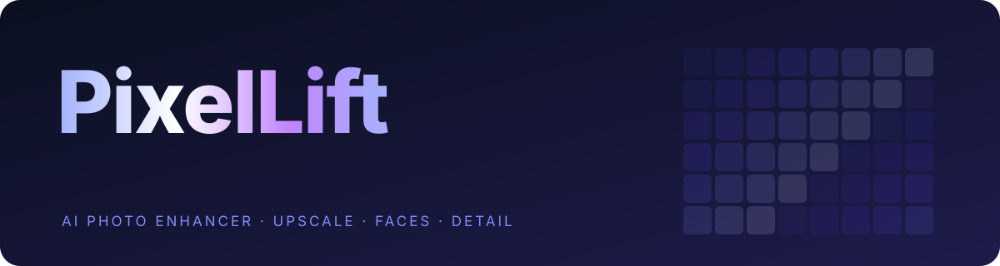
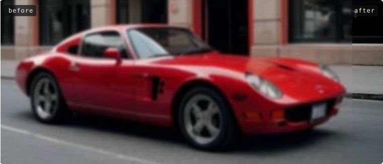
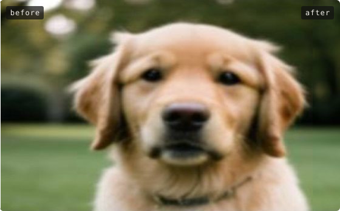
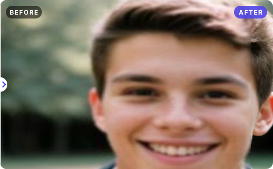
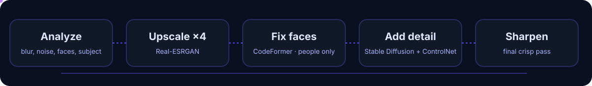

<p align="center">
  
</p>

<p align="center">
  
  
  
  
  
  
</p>

**PixelLift** turns small, blurry photos into sharp, detailed ones. Drop a photo and pick a size; the AI decides everything else — which upscaler to use, whether faces need fixing, how much noise to clean up and how to balance the colour. Everything runs on your own computer.

## See it

<p align="center">
  
</p>
<p align="center">
  
  
</p>
<p align="center"><sub>Test photos are AI-generated, then blurred and shrunk. Faces are only redrawn on people — the dog keeps its own.</sub></p>

## How it works

<p align="center">
  
</p>

Each photo is analysed first, and that analysis picks the plan:

- **Upscaler** — Real-ESRGAN x4plus for photos, a lighter model for older GPUs, an anime model for drawings, pixel-perfect scaling for pixel art and plain resampling for very large photos.
- **Blown-up pictures** — a photo with far less detail than pixels is shrunk to its real detail level first, so the AI sharpens it instead of painting smears.
- **Faces** — small or blurry human faces are redrawn with CodeFormer. A small classifier checks for animals first, so dogs and cats keep their own faces.
- **Realistic detail** — with the optional local AI server running, Stable Diffusion (Realistic Vision 5.1 + ControlNet Tile) redraws fine texture at the full output size, then a light final sharpening.
- **Cleanup** — noise, JPEG blocks, exposure and white balance are fixed from the same analysis.

The **Analyze** tab shows the full report: quality score, sharpness, noise, exposure, colour cast, palette, histogram and camera data.

## Quick start

Needs [Node.js](https://nodejs.org) 20.19+ or 22.12+ and Chrome or Edge.

```bash
npm install
npm run dev
```

Open http://localhost:5173, drop a photo, pick a quality and press **Enhance image**. The big models (36 MB upscaler, 377 MB face model) download once on first use and are kept in the browser.

## Optional: local AI server

For the most detailed results, run the Stable Diffusion server on an NVIDIA GPU (8 GB or more). While it runs, the app sends all AI work to it, so the browser stays off the GPU.

```bash
python -m venv D:/PixelLift/ai/venv
D:/PixelLift/ai/venv/Scripts/python.exe -m pip install torch==2.11.0 --index-url https://download.pytorch.org/whl/cu128
D:/PixelLift/ai/venv/Scripts/python.exe -m pip install -r server/requirements.txt
D:/PixelLift/ai/venv/Scripts/python.exe server/fetch_models.py
D:/PixelLift/ai/venv/Scripts/python.exe server/app.py
```

`fetch_models.py` downloads about 3.6 GB and checks every file against its published SHA-256. Models go to `D:/PixelLift/ai/models` unless you set `PIXELLIFT_MODELS`. The server only listens on `127.0.0.1:7861`; when it is ready the app's plan shows **Realistic detail · Stable Diffusion**.

## Models

| Model | Used for | Comes from | Size | License |
| --- | --- | --- | --- | --- |
| Real-ESRGAN general v3 / AnimeVideo v3 | Fast upscaling | bundled | 3.7 MB | BSD-3-Clause |
| Real-ESRGAN x4plus | HQ upscaling | downloaded once | 36 MB | BSD-3-Clause |
| YuNet | Finding faces | bundled | 0.2 MB | MIT |
| MobileNetV4 small | Animal check | bundled | 15 MB | Apache-2.0 |
| CodeFormer | Face restoration | downloaded once | 377 MB | S-Lab 1.0, **non-commercial** |
| Realistic Vision 5.1, sd-vae-ft-mse, ControlNet Tile | Local AI server | `fetch_models.py` | 3.2 GB | CreativeML OpenRAIL-M, MIT, OpenRAIL |

Downloaded models are pinned by SHA-256. CodeFormer's license allows non-commercial use only.

## Project layout

```text
src/
  core/      analysis, enhancement pipeline, filters, resizing, the automatic plan
  ai/        upscalers, face finder and fixer, animal check, ONNX and server helpers
  ui/        panels, before/after viewer, queue
  worker.js  all heavy work, off the main thread
server/      optional local AI server (FastAPI, diffusers, ONNX Runtime GPU)
public/      bundled small models
tests/       Vitest suites
docs/        README graphics
```

## Scripts

| Command | What it does |
| --- | --- |
| `npm run dev` | Start the app with live reload |
| `npm run build` | Build for production into `dist/` |
| `npm run preview` | Serve the production build |
| `npm test` | Run the test suite |

## Notes

- **Privacy** — photos never leave your computer. The only network requests are the one-time model downloads.
- **GPU crashes** — if Windows crashes with a graphics-driver error (0x113) under heavy AI load, update or clean-install the NVIDIA driver.
